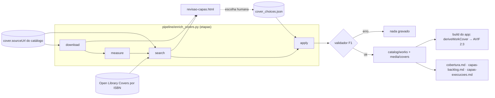

# Design — Capas de obras (F2 · frente 2)

Referência: [`requirements.md`](requirements.md).

## Visão geral

Uma CLI nova no pipeline e uma extensão na derivação de imagem do app. Tudo
reaproveita a infraestrutura já madura da F2.1 (cliente HTTP com cache, aferição
de imagem, seleção por pendência/prioridade, fluxo "validar antes de gravar",
folha HTML de revisão, log de execuções).

- `pipeline/enrich_covers.py`: baixa os mestres das capas, mede resolução, busca
  as que faltam em **fontes gratuitas** e aplica a escolha humana ao catálogo.
- `app/src/lib/images.ts`: ganha `deriveWorkCover`, irmã de `deriveAuthorPhoto`,
  lendo os mestres de `catalog/media/covers/*`. `Cover`/`CoverCaption` passam a
  mostrar o derivado quando houver capa escolhida.



O que **não** muda nesta onda: nenhum provedor com cota (SerpApi/Tavily), nenhum
custo. O que sobrar vai para `docs/plans/capas-backlog.md` (segunda onda, paga).

## Princípio de fluxo (igual às fotos de autoria)

A capa real **nunca** entra sozinha. O pipeline reúne a candidata e a põe na
folha de revisão ao lado da tipográfica; a Lila decide por obra; a decisão vira
uma entrada em `pipeline/config/cover_choices.json`; só então a etapa `apply`
promove o mestre e escreve o catálogo. Sem decisão, o app segue na tipográfica.
É o mesmo contrato de `author_photos.json` + `photo_pending` da F2.1.

## Pipeline

### CLI e etapas

```bash
python3 pipeline/enrich_covers.py --dry-run                 # plano, sem baixar nada
python3 pipeline/enrich_covers.py --steps download,measure  # baixa e mede os 223 mestres
python3 pipeline/enrich_covers.py --steps search            # busca gratuita das que faltam/baixas
python3 pipeline/enrich_covers.py --steps apply             # aplica cover_choices.json ao catálogo
python3 pipeline/enrich_covers.py --only slug-da-obra       # manutenção (obra nova)
```

- Etapas: `download`, `measure`, `search`, `apply` (R8.1). Sem `--steps`, roda
  todas na ordem.
- `--only slug,...`, `--limit N`, `--refresh`, `--dry-run` (R8.1–8.2).
- Seleção padrão: só obras **pendentes** (R8.3), por prioridade de visibilidade
  reusando `selection.priority_key` adaptado a obras (nº de leituras da obra →
  presença no ano corrente → slug).
- Código de saída: 0 ok; 1 falhas ou catálogo resultante inválido; 2 catálogo de
  partida inválido. Mesmo contrato de `enrich_authors.py`.

### Estrutura de código (espelha `lib/authors/`)

Novo pacote `pipeline/lib/covers/` + o `enrich_covers.py` no topo:

| Módulo | Papel |
|---|---|
| `covers/context.py` | `CoverContext` + `Waves` (etapas selecionadas); carrega `enrich.json` (bloco `cover`), `cover_choices.json`, `budgets.json`, catálogo e estado. |
| `covers/download.py` | baixa `cover.sourceUrl` → mestre em staging; extensão pelo content-type real. |
| `covers/measure.py` | aferição via `lib.images.sniff`; classifica boa/limítrofe/baixa; grava dimensão e proporção no estado. |
| `covers/search.py` | fontes gratuitas: a própria `sourceUrl` e Open Library Covers por ISBN; descarta placeholder e imagem pequena. |
| `covers/apply.py` | lê `cover_choices.json`, promove o mestre escolhido e monta o objeto `cover` enriquecido. |
| `lib/covers/select.py` | `cover_pending` e prioridade das obras (irmão de `selection.py`). |

Reúso direto, sem duplicar:

- **`lib/http.Http`** — cache, retries, pausa, `offline_providers`, contadores
  rede×cache. O download de imagem usa `get_bytes` (provedor `images`); a Open
  Library usa `get_json`/`get_bytes` (provedor `openlibrary`). O dry-run bloqueia
  `{"images", "openlibrary"}`, como `DRY_RUN_BLOCKED` bloqueia os pagos.
- **`lib.images.sniff`** — já lê dimensão de JPEG/PNG/WEBP/GIF (R2.1). Nada novo.
- **`lib.checks`** — ganha `check_covers` (espelho de `check_photos`): todo
  `cover.file` referenciado deve existir em `catalog/media/covers/`.
- **`lib.jsonio.write_catalog`** + o par `commit`/validação de `enrich_authors.py`
  — a gravação só acontece se `check_catalog` passar (R5.5).
- **`lib.enrich_report`** — ganha `render_covers_html` e uma linha de capas no
  log de execução; o `cobertura.md` ganha a seção de capas.
- **`lib.budget`** — permanece válido para a 2ª onda; nesta onda nenhum provedor
  com cota é chamado, então a guarda não bloqueia (R8.7).

### Etapa `download` (R1)

Para cada obra com `cover.sourceUrl` e sem mestre local decidido:

1. `http.get_bytes("images", sourceUrl)`.
2. `info = images.sniff(bytes)`. Sem reconhecimento → falha registrada (R1.3),
   obra segue sem capa local.
3. Grava o mestre em **staging** (`tempfile.mkdtemp`, como as fotos) com
   `{slug}.{info.ext}`; a promoção para `catalog/media/covers/` é no `commit`,
   depois da validação (não grava mídia de catálogo inválido).
4. Sem redimensionar nem recortar (R1.2).

O `content-type` manda na extensão (R1.1); se vier genérico, cai no `info.ext`
do sniff. O cache de `get_bytes` evita rebaixar na reexecução (R1.4, R8.6).

### Etapa `measure` (R2)

`info.min_side` classifica (limiares em `enrich.json → cover`):

| Classe | Regra | Destino |
|---|---|---|
| boa | `min_side ≥ 400` | candidata direta à revisão |
| limítrofe | `250 ≤ min_side < 400` | revisão, marcada "baixa resolução" |
| baixa | `min_side < 250` | não oferecida sem substituição → vai para `search` |

Proporção `width/height` guardada no estado; capas longe de 2:3 (ex.: fora de
`[0.60, 0.72]`) recebem a marca "verificar enquadramento" (R2.6 → R6.4).

### Etapa `search` — só gratuito (R3)

Para obras sem `sourceUrl` e para as "baixas", nesta ordem (R3.1):

1. A própria `cover.sourceUrl`, quando existir (já tratada no `download`).
2. **Open Library Covers**: `https://covers.openlibrary.org/b/isbn/{isbn}-L.jpg`
   por `isbn13`, depois `isbn10` (R3.1, R3.4). O `-L` pede o maior tamanho.
   - A API devolve **200 com um GIF de 1×1** (ou 807 bytes) quando não há capa;
     por isso usamos `?default=false`, que responde **404** sem capa. O 404 é
     cacheável (está em `CACHEABLE_STATUSES`), então uma obra sem capa na OL não
     repete a chamada.
   - A imagem recebida passa pela aferição do R2; placeholder/pequena é
     descartada (R3.3).
3. Nada de SerpApi/Tavily (R3.2). Obra que nenhuma fonte gratuita resolveu entra
   em `capas-backlog.md`.

`User-Agent` identificável à Open Library e os mesmos limites de taxa do `Http`
(R3.5); `minIntervalSeconds.openlibrary` em `enrich.json`.

### Etapa `apply` (R4, R5, R6)

Lê `pipeline/config/cover_choices.json`:

```json
{
  "a-caverna-jose-saramago": {
    "url": "https://covers.openlibrary.org/b/isbn/9788535902778-L.jpg",
    "source": "openlibrary",
    "focus": "top"
  },
  "dom-casmurro-machado-de-assis": { "typographic": true },
  "obra-sem-capa-boa":            { "none": true }
}
```

- `url` → promove o mestre correspondente e monta o `cover` enriquecido (R5.1);
  `focus` opcional entra no `cover` (R6.2).
- `typographic: true` → grava `cover.display = "typographic"` (R4.2, R5.2):
  revisada, fica tipográfica. Distingue de "ainda não revisada".
- `none: true` → sem capa aceitável; segue tipográfica, sem marcar `display`
  (fica no relatório para a 2ª onda).
- A decisão manual vence a classificação automática (R4.3): uma "limítrofe"
  escolhida é usada; uma "boa" marcada `typographic` cai na tipográfica.

Só a capa escolhida é promovida (R4.4). Sem entrada em `cover_choices.json`, a
obra fica pendente e o app mostra a tipográfica (R4.5, R8.3).

### Esquema do catálogo (R5)

`cover` hoje é `{ sourceUrl, source } | null`. Fica **aditivo** — os campos novos
são opcionais, então as 302 obras atuais seguem válidas:

```json
"cover": {
  "file": "covers/a-caverna-jose-saramago.jpg",
  "license": null,
  "credit": null,
  "focus": "top",
  "display": null,
  "sourceUrl": "https://covers.openlibrary.org/b/isbn/9788535902778-L.jpg",
  "source": "openlibrary"
}
```

Mudanças em três lugares que precisam andar juntos (a regra "o Zod espelha o
JSON Schema" do app):

1. `catalog/schema/work.schema.json` — `cover` ganha `file`, `license`, `credit`,
   `focus` (`"top"|"center"|"bottom"` ou `null`), `display` (`"typographic"|null`),
   todos opcionais; `file` casa `^covers/[a-z0-9-]+\.(jpg|png|webp|gif)$`.
2. `app/src/lib/catalog/schema.ts` — o `workSchema.cover` Zod recebe os mesmos
   campos, opcionais/nuláveis.
3. `docs/DATA_MODEL.md` — documenta o formato e a diferença entre `display`
   nulo (não revisada) e `"typographic"` (revisada).

A migração da F1 preserva `cover.file`/`license`/`credit`/`focus`/`display` ao
reescrever a obra a partir do CSV (R5.4) — hoje ela recompõe `cover` do zero;
passa a mesclar os campos enriquecidos existentes, como já faz com país/foto da
autoria. Teste de preservação no R10.3.

### Enquadramento (R6)

O mestre nunca é cortado (R6.5). O corte é só no derivado do build:

- Sem `focus` → `object-position: center` (padrão, R6.1).
- `focus: "top"|"bottom"` → `object-position: top|bottom`. (Uma % futura cabe no
  mesmo campo sem mudar o schema, mas começamos com os três valores nomeados,
  que cobrem o caso real "título no topo/rodapé".)

### Relatórios (R9)

- `docs/plans/revisao-capas.html` (fora do git): por obra pendente, a candidata
  real renderizada em 2:3 com corte central + a tipográfica ao lado (reaproveita
  a mesma marcação/cores do `TypographicCover`), resolução, classe e origem.
  Texto de ajuda: copiar o bloco escolhido para `cover_choices.json` e rodar
  `--steps apply`. Espelha `render_photos_html`.
- `docs/plans/capas-backlog.md`: obras sem capa gratuita (2ª onda).
- `docs/plans/capas-execucoes.md`: uma entrada por execução real (data, seleção,
  etapas, obras, fonte catálogo×OL, downloads rede×cache, falhas). Espelha
  `render_run_entry`.
- `docs/plans/cobertura.md`: seção de capas (boa / limítrofe / só tipográfica /
  pendente / backlog).

## App

### `deriveWorkCover` em `images.ts` (R7)

Hoje `images.ts` só conhece `catalog/media/authors`. Acrescenta um segundo glob
e uma função irmã, sem tocar na de autoria:

```ts
const coverMasters = import.meta.glob<{ default: ImageMetadata }>(
  "../../../catalog/media/covers/*.{jpg,png,webp,gif}",
  { eager: true },
);
const coverMasterByFile = new Map<string, ImageMetadata>(/* file → metadata */);

export type CoverFocus = "top" | "center" | "bottom";

export async function deriveWorkCover(
  coverFile: string,            // "covers/slug.jpg"
  focus: CoverFocus = "center",
  widths: readonly number[] = COVER_WIDTHS,
): Promise<DerivedImage | null> { /* getImage fit:"cover", position: focus, 2:3, avif */ }

export function hasWorkCover(coverFile: string): boolean { /* ... */ }
```

- Reusa `COVER_WIDTHS = [104,136,272]`, `heightFor(w, "2:3")`, `buildSrcset`
  (passa a aceitar `position`). O `position` é o único acréscimo ao helper.
- Devolve `null` quando não há mestre (ou o arquivo foi marcado tipográfico) → o
  chamador cai na tipográfica (R7.3).

### Ligação nos componentes (R7.3–7.6)

O `Cover.astro` já aceita `image?: DerivedImage | null` e cai na tipográfica
quando nulo — nada muda nele. Quem muda é quem **monta** a capa, hoje sempre
nulo. Duas opções, e o design escolhe a segunda:

- ❌ Derivar dentro de `Cover.astro`: espalharia `await getImage` e a regra de
  decisão pelo componente burro.
- ✅ Uma função de view que decide `coverFile`/`focus` por obra e um ponto único
  que deriva. Como `CoverCaption` recebe uma `WorkView` e grades/carrosséis/Obra
  passam por ele (e a Obra usa `Cover` direto via `WorkHeader`), a decisão vai
  para a **camada de dados**:
  - `model.ts → WorkView` ganha `coverFile: string | null`, `coverFocus:
    CoverFocus`, `coverDisplay: "typographic" | null` (derivados de `w.cover`;
    `coverSourceUrl` continua existindo e continua proveniência).
  - `CoverCaption.astro` e `WorkHeader.astro` chamam `deriveWorkCover` quando
    `work.coverFile && work.coverDisplay !== "typographic"`, e passam o resultado
    ao `Cover`. Sem mestre → `null` → tipográfica, HTML idêntico ao de hoje.

Isso mantém a convenção da S5 (regra em `src/lib`, `.astro` burro) e garante o
R7.6: para obras sem capa, a saída é byte a byte a de hoje. O diff de HTML contra
a `main` (baseline em `temp/`, normalizando `data-astro-cid-*`) prova isso.

### `src` nunca é a origem (R7.4)

`deriveWorkCover` só usa o `ImageMetadata` do glob local. `coverSourceUrl` nunca
entra no `img`. Mantém R6.4 da S1.

## Configuração nova

`pipeline/config/enrich.json` ganha o bloco `cover`:

```json
"cover": {
  "goodMinSide": 400,
  "rejectBelow": 250,
  "aspectRange": [0.60, 0.72],
  "openLibrarySize": "L"
}
```

`minIntervalSeconds` ganha `openlibrary` e `images`. `cover_choices.json` começa
`{}`. Nenhuma mudança em `budgets.json` (a guarda já existe para a 2ª onda).

## Decisões e alternativas

- **Open Library com `?default=false`** para ter 404 em vez do GIF de "sem capa":
  evita baixar e medir placeholder e aproveita o cache de 404 do `Http`.
  Verificado em uso público da API (um worker que tenta `…-L.jpg?default=false`
  e ramifica por `response.ok`, [gist de maio/2024](https://gist.github.com/jamesflores/85e9777d5ca076b2d29312a31754003e)).
  Como a OL já devolveu placeholder com 200 em casos antigos
  ([relato no SO](https://stackoverflow.com/questions/38292477/openlibrary-org-returns-blank-image-how-to-detect-and-replace-them)),
  a aferição do R2 fica como rede de segurança mesmo com o 404. Conteúdo
  reescrito para conformidade de licença.
- **`display: "typographic"` em vez de um booleano "revisada"**: um só campo diz
  "revisada e a escolha é a tipográfica"; `file` presente diz "revisada, usa a
  real"; ambos ausentes = não revisada. Três estados, dois campos, sem flag
  redundante.
- **Crédito da imagem como `credit` no `cover`** (não `author`, que colidiria com
  a autoria do livro). **A observar no futuro:** por consistência, o campo
  `author` da foto de autoria (`PhotoView.author`/`photo.author`) deveria ser
  renomeado para `credit` também. Fora do escopo desta spec; anotado aqui e em
  `docs/plans/handover-*` quando esta spec fechar, para uma limpeza futura.
- **`focus` com três valores nomeados**, não %: cobre o caso real com o A ágil; a
  % cabe no mesmo campo depois, sem migração, se surgir necessidade.
- **Staging + promoção no commit** (não gravar direto em `catalog/media/`): não
  deixa mídia órfã se a validação falhar; é o que as fotos já fazem.
- **Sem cota nesta onda**: simplifica o dry-run (sem cálculo de saldo pago) e
  torna a spec reexecutável sem risco de gasto. A 2ª onda reusa `enrich_covers.py`
  acrescentando um `search` pago, sem redesenho.

## Testes (R10)

**Pipeline (`pipeline/tests/`, stdlib `unittest`, offline com fixtures):**

- `download`: content-type → extensão; bytes não-imagem → falha registrada.
- `measure`: `sniff` em JPEG/PNG/WEBP mínimos; limiares boa/limítrofe/baixa;
  marca de proporção fora de 2:3.
- `search`: OL `-L` por isbn13 e fallback isbn10; `?default=false` → 404 tratado;
  placeholder/pequena descartada; obra sem fonte → backlog.
- `apply`: `url`/`typographic`/`none`; precedência da decisão manual sobre a
  classe; `focus` no objeto `cover`.
- `commit`: catálogo resultante inválido → nada gravado; `check_covers` acusa
  `cover.file` sem arquivo.
- `--dry-run` não baixa nada; cache evita rede na 2ª execução; idempotência
  byte a byte.
- **Migração F1**: preserva `cover.file`/`license`/`credit`/`focus`/`display`
  (R10.3).

**App (`app/src/lib/*.test.ts`, `node --test`):**

- `model.ts`: `w.cover` → `coverFile`/`coverFocus`/`coverDisplay` (com/sem
  campos novos; `display:"typographic"` zera a seleção).
- `route-integrity`/HTML-diff: telas sem capa inalteradas.
- `images.ts` não é exercitado pelo `node --test` (depende de `astro:assets`),
  como hoje; a cobertura dele é a seleção em `model.ts` + a verificação por build.

## Verificação (fecho da spec)

1. `python3 -m unittest discover -s pipeline/tests` verde.
2. `python3 pipeline/validate_catalog.py` em código 0 (schema novo, covers
   existentes).
3. `app`: `npm run check` limpo e `node --test` verde.
4. `npm run build` em código 0, agora com as capas escolhidas derivadas.
5. Diff de HTML contra a `main` para obras sem capa: sem mudança.
6. Conferir visualmente em `/styleguide` e numa grade real antes do PR.

## Fora do escopo (reafirmado)

SerpApi/Tavily e qualquer capa paga (2ª onda); temas, resumos de ano/país,
títulos originais/`first_publication_year`; S6/S7; revisão contínua de autorias;
redesenho da capa tipográfica; otimização de imagem além do build.
