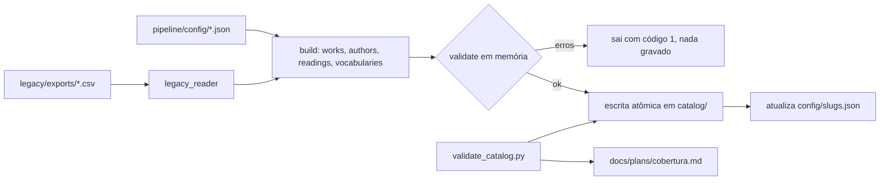

# Design — Catálogo canônico (F1)

Referência: [`requirements.md`](requirements.md).

## Visão geral

Dois scripts Python, só com a biblioteca padrão (o ambiente é Python 3.9.6):

- `pipeline/migrate_legacy.py` lê os CSVs de `legacy/exports/`, monta o modelo
  em memória, valida e só então grava `catalog/`.
- `pipeline/validate_catalog.py` lê `catalog/`, confere schema, referências e
  invariantes, e gera `docs/plans/cobertura.md`.



A migração e o validador usam **o mesmo código de validação** (`lib/checks.py`).
Assim a migração nunca grava um catálogo que o validador rejeitaria.

## Estrutura de arquivos

```text
pipeline/
  migrate_legacy.py        CLI de migração
  validate_catalog.py      CLI de validação + relatório
  lib/
    __init__.py
    slugs.py               slugify, truncamento, desempate, mapa persistente
    names.py               unificação de autorias e escolha do nome canônico
    titles.py              separação título original / romanização
    legacy_reader.py       leitura e checagem de colunas dos CSVs
    build.py               montagem do modelo (obras, autorias, leituras, vocabulários)
    jsonio.py              leitura e escrita canônica, escrita atômica
    schema.py              validador mínimo de JSON Schema
    checks.py              regras de integridade e invariantes
    coverage.py            relatório de cobertura
  config/
    slugs.json             mapa persistente de slugs (gerado, versionado)
    author_overrides.json  exceções manuais de nome e slug de autoria
  tests/
    test_*.py
catalog/
  works/{slug}.json
  authors/{slug}.json
  readings.json
  summaries.json
  vocabularies.json
  schema/
    work.schema.json
    author.schema.json
    readings.schema.json
    summaries.schema.json
    vocabularies.schema.json
```

## Modelo de dados

Todos os campos existem sempre. Ausência é `null` ou `[]`, nunca string vazia
(Req. 2.5).

### Obra — `catalog/works/a-vegetariana-han-kang.json`

```json
{
  "slug": "a-vegetariana-han-kang",
  "title": "A Vegetariana",
  "originalTitle": "채식주의자",
  "originalTitleRomanized": "Chaesikjuuija",
  "authors": ["han-kang"],
  "language": "coreano",
  "firstPublished": 2007,
  "type": "romance",
  "genres": ["drama psicológico", "ficção literária"],
  "themes": ["corpo", "família", "liberdade", "loucura", "violência"],
  "edition": {
    "title": "A Vegetariana",
    "language": "português",
    "publisher": "Todavia",
    "year": 2018,
    "isbn13": "9788588808294",
    "isbn10": null,
    "format": "brochura",
    "match": "representative"
  },
  "cover": {
    "sourceUrl": "https://assets.literal.club/3/cksj5wvsy1084367q298bwk52jgt.jpg",
    "source": "literal"
  },
  "catalogerNote": "…",
  "confidence": "high",
  "references": [
    { "provider": "literal", "id": "cksj…", "url": null, "fields": "edição, ISBN, editora, capa" },
    { "provider": "openlibrary", "id": "OL…W", "url": "https://openlibrary.org/works/OL…W", "fields": "…" },
    { "provider": "web", "id": null, "url": "https://…", "fields": null }
  ],
  "legacyId": "work-8a1409675d20",
  "audit": {
    "validationStatus": "validated",
    "sourceConflicts": null,
    "validatedAt": "2026-08-13"
  }
}
```

Mapeamento a partir de `obras.csv`:

| Campo | Origem | Regra |
|---|---|---|
| `title` | `title_pt_br` | `strip()` |
| `originalTitle`, `originalTitleRomanized` | `original_title` | ver "Títulos originais" |
| `authors` | `authors` | split em `;`, `strip()`, mapeado para slug de autoria, ordem preservada |
| `language`, `type` | `original_language`, `work_type` | como estão |
| `firstPublished` | `first_publication_year` | `int` ou `null` |
| `genres`, `themes` | idem | split em `;`, `strip()`, sem vazios, sem repetidos, ordem preservada |
| `edition.*` | `edition_title`, `edition_language`, `publisher`, `edition_publication_year`, `isbn13`, `isbn10`, `physical_format`, `edition_match` | `physical_format = "desconhecido"` vira `null`; ISBN só dígitos (e `X` no ISBN-10) |
| `cover` | `cover_url`, `cover_source` | sem `cover_url` → `cover: null`, mesmo que `cover_source` exista (17 casos) |
| `catalogerNote` | `decision_reason` | |
| `confidence` | `confidence` | `high` · `medium` · `low` |
| `references` | `obras.csv` + `fontes.csv` | ver "Referências" |
| `audit` | `validation_status`, `source_conflicts`, `validated_at` | |

Campos do CSV **descartados** por serem derivados ou redundantes:
`reading_sequences`, `reading_count` (calculados de `readings.json`) e as
colunas de URL que se repetem em `references`.

### Autoria — `catalog/authors/luis-fernando-verissimo.json`

```json
{
  "slug": "luis-fernando-verissimo",
  "name": "Luís Fernando Veríssimo",
  "aliases": ["Luis Fernando Verissimo"],
  "country": null,
  "languages": ["português"],
  "primaryLanguage": "português",
  "bio": null,
  "photo": null,
  "references": []
}
```

`bio` e `photo` serão objetos na F2 (`{ text, source, url }` e
`{ file, license, author, sourceUrl }`). O schema já aceita `null` ou esse
objeto, para a F2 não precisar mudar o formato.

### Leituras — `catalog/readings.json`

```json
{
  "readings": [
    {
      "sequence": 1,
      "year": null,
      "work": "os-espioes-luis-fernando-verissimo",
      "reread": false,
      "originalEntry": "Os espiões - Luiz Fernando Veríssimo",
      "notes": null
    }
  ]
}
```

O arquivo é um objeto com a chave `readings`, e não uma lista solta, para
permitir metadados no futuro sem mudar o formato.

### Resumos — `catalog/summaries.json`

```json
{ "summaries": [] }
```

Formato de cada item (usado na F2):
`{ "scope": "ano:2024", "text": "…", "approved": false, "updatedAt": "2026-11-01", "source": "…" }`.

### Vocabulários — `catalog/vocabularies.json`

```json
{
  "languages": ["alemão", "árabe", "catalão", "…"],
  "workTypes": ["autoajuda", "autobiografia/memórias", "…"],
  "genres": ["…"],
  "themes": ["…"]
}
```

Nesta fase, os vocabulários são **derivados dos dados**: o conjunto de valores
usados, ordenado por uma chave sem acentos e em minúsculas (desempate pelo
próprio texto). Na F2, eles passam a ser editados à mão e o validador passa a
pegar valores fora da lista. A F2 vai precisar de uma flag para não regenerar
os vocabulários; essa flag não entra nesta spec.

## Regras de transformação

### Slugs (`lib/slugs.py`)

```text
slugify(s):
  NFKD → remove marcas combinantes → minúsculas
  troca [^a-z0-9]+ por "-" → remove "-" das pontas
```

- Caracteres não latinos somem no slugify. Por isso o slug de obra usa o
  título pt-BR, que é sempre latino.
- **Obra:** `slugify(title + " " + nomeCanônicoDaPrimeiraAutoria)`.
- **Autoria:** `slugify(nomeCanônico)`, salvo exceção em `author_overrides.json`.
- **Truncamento (Req. 5.6):** se passar de 80 caracteres, corta no último hífen
  até 80 caracteres. Pelos dados, título mais autoria chega a ~92 caracteres,
  então isso acontece.
- **Desempate (Req. 5.3):** colisão de slug novo → acrescenta
  `-{firstPublished}`; se ainda colidir ou não houver ano, `-2`, `-3`… As obras
  são processadas em ordem de `legacyId`, para o desempate ser determinístico.
- **Mapa persistente (Req. 5.4–5.5):** `pipeline/config/slugs.json`:

```json
{
  "works": { "work-8a1409675d20": "a-vegetariana-han-kang" },
  "authors": { "luis fernando verissimo": "luis-fernando-verissimo" }
}
```

  A chave de autoria é o nome sem acentos e em minúsculas (a mesma chave da
  unificação). Slugs já mapeados são reutilizados e reservados antes de gerar
  os novos, para que um slug novo nunca roube um antigo. O mapa só ganha
  entradas; nunca perde. Em `--dry-run`, o mapa não é gravado.

### Unificação de autorias (`lib/names.py`)

1. A chave de unificação é o nome sem acentos, em minúsculas, com espaços
   normalizados. É ela que agrupa "Luís Fernando Veríssimo" e
   "Luis Fernando Verissimo" (Req. 3.2).
2. **Nome canônico** do grupo (Req. 3.3), pelo maior placar, em ordem:
   1. tem a primeira letra de cada palavra maiúscula (partículas como "de",
      "da", "do", "dos", "das", "e" não contam);
   2. número de caracteres com acento;
   3. frequência nas obras;
   4. ordem alfabética, como último desempate.
3. As demais grafias vão para `aliases`, ordenadas.
4. **Exceções (Req. 3.4):** `pipeline/config/author_overrides.json`, indexado
   pela chave de unificação:

```json
{
  "valter hugo mae": { "name": "valter hugo mãe", "slug": "valter-hugo-mae" }
}
```

   A exceção vence a regra e o mapa de slugs. O arquivo inicial terá só esse caso.
5. **Idiomas (Req. 3.6):** `languages` é o conjunto dos `language` das obras da
   autoria, do mais para o menos frequente (desempate pela menor `sequence`).
   `primaryLanguage` é o primeiro dessa lista.
6. **Caso conhecido não resolvido pela regra:** "Luiz Fernando Veríssimo" (com
   "z") pode aparecer em `original_entry`, mas só os nomes da coluna `authors`
   são usados. Variações com letras diferentes, e não só acentos, não são
   unificadas automaticamente: elas vão para o relatório como **suspeitas**
   (mesmo sobrenome e iniciais iguais) para revisão humana.

### Títulos originais (`lib/titles.py`)

```text
split_original(s):
  s vazio → (null, null)
  casa ^(.+?)\s*\(([^()]+)\)$ E a parte de fora tem caractere não latino
    → (parte de fora, parte entre parênteses)
  senão → (s, null)
```

"Não latino" é qualquer letra fora dos blocos Latin (até U+024F) e Latin
Extended Additional. Com isso, um título latino com parênteses legítimos não é
cortado. Os dados atuais têm exatamente 8 casos que casam, todos em japonês,
coreano ou hebraico.

### Referências

Cada obra recebe uma lista `references` de `{ provider, id, url, fields }`:

- A base são as linhas de `fontes.csv` com o mesmo `work_id`
  (providers `literal`, `openlibrary`, `google_books`, `busca_web`, com
  `busca_web` renomeado para `web`).
- Depois entram os ids e URLs de `obras.csv` que ainda não estejam na lista
  (`literal_book_id`, `literal_work_id`, `openlibrary_work_id`,
  `openlibrary_edition_id`, `google_books_id`, `wikidata_id` e as URLs
  correspondentes).
- Por fim, cada URL de `additional_reference_urls` (split em `; `) vira
  `{ provider: "web", id: null, url, fields: null }`.
- Duplicatas por `(provider, id, url)` são removidas. A ordem é a de origem:
  `fontes.csv`, colunas de `obras.csv` e URLs adicionais.

### Leituras

- Lidas de `leituras.csv`: `sequence` vira `int`, `read_year` vazio vira `null`,
  `reread` passa de `sim`/`não` para booleano, `reading_notes` vazio vira
  `null`, e `work_id` é mapeado para o slug da obra.
- O `reread` do CSV é mantido como está, e o validador confere a coerência
  (Req. 7.4).

## Escrita canônica e atômica (`lib/jsonio.py`)

- `json.dumps(obj, ensure_ascii=False, indent=2)` mais `"\n"` no fim, gravado em
  UTF-8 (Req. 1.8).
- **Ordem das chaves:** a ordem de construção dos dicts no `build.py`, que segue
  a ordem das propriedades no schema. Não se usa `sort_keys`, para manter `slug`
  e `title` no topo e o arquivo legível. Listas de valores (temas, aliases) têm
  ordem definida pelas regras acima.
- **Atomicidade (Req. 6.5):**
  1. tudo é montado e validado em memória;
  2. os arquivos vão para um diretório temporário irmão (`catalog/.tmp-migrate/`);
  3. `works/` e `authors/` são substituídos por renomeação (`os.replace`); os
     arquivos soltos também. Assim, obras removidas ou renomeadas não deixam
     arquivo órfão;
  4. em qualquer erro antes do passo 3, o temporário é apagado e `catalog/` fica
     como estava.
- `catalog/schema/`, `catalog/source/` e `catalog/media/` nunca são tocados pela
  migração.
- **Idempotência (Req. 6.2):** não se grava data de execução e toda ordem é
  determinística. O teste roda a migração duas vezes e compara os bytes.

## Validação de schema (`lib/schema.py`)

Sem dependências externas não há biblioteca `jsonschema`. Os schemas em
`catalog/schema/` são **JSON Schema 2020-12 válidos**, para servir também a
ferramentas externas (o app em TypeScript pode usar Zod ou Ajv). O validador
Python implementa só o subconjunto usado:

`type` (incluindo listas como `["string","null"]`), `properties`, `required`,
`additionalProperties: false`, `items`, `enum`, `const`, `pattern`,
`minimum`, `maximum`, `minLength`, `maxLength`, `minItems`, `uniqueItems`,
`$ref` local (`#/$defs/...`) e `oneOf` (para `null | objeto`).

Se aparecer uma palavra-chave que ele não conhece, o validador **falha**, em vez
de ignorá-la. Assim, o schema nunca promete uma regra que não é conferida.

Restrições principais:

| Campo | Regra |
|---|---|
| `slug`, refs a obra/autoria | `pattern: ^[a-z0-9]+(-[a-z0-9]+)*$`, `maxLength: 80` |
| `firstPublished`, `edition.year`, `year` da leitura | inteiro, `minimum: 1000`, `maximum: 2100`, ou `null` |
| `sequence` | inteiro ≥ 1 |
| `edition.isbn13` | `^97[89][0-9]{10}$` ou `null` |
| `edition.isbn10` | `^[0-9]{9}[0-9X]$` ou `null` |
| `edition.match` | `enum: [exact, representative]` |
| `confidence` | `enum: [high, medium, low]` |
| `country` | `^[A-Z]{2}$` ou `null` |
| `summaries[].scope` | `^(autoria:[a-z0-9-]+|ano:[0-9]{4}|pais:[A-Z]{2})$` |
| strings de conteúdo | `minLength: 1` (string vazia nunca é válida) |

## Regras do validador (`lib/checks.py`)

Cada regra devolve uma lista de `Issue(file, path, message)`. Todas as regras
rodam até o fim, sem parar no primeiro erro (Req. 7.8).

| Código | Regra | Req. |
|---|---|---|
| `schema` | cada arquivo contra seu schema | 7.2 |
| `ref.reading-work` | toda leitura aponta para obra existente | 7.3 |
| `ref.work-author` | toda autoria citada em obra existe | 7.3 |
| `orphan.work` | toda obra tem ≥ 1 leitura | 7.3 |
| `orphan.author` | toda autoria tem ≥ 1 obra | 7.3 |
| `seq.contiguous` | sequências 1..N, sem lacunas nem repetidas | 7.4 |
| `year.monotonic` | anos não decrescentes ao longo da sequência, ignorando `null` | 7.4 |
| `year.undated-head` | leituras 1–53 com `year: null` | 7.4 |
| `reread.order` | `reread: true` ⇔ não é a primeira leitura (menor `sequence`) da obra | 7.4 |
| `file.slug` | nome do arquivo = `slug` + `.json`; slugs únicos | 7.5 |
| `vocab` | idioma, tipo, gêneros, temas e `primaryLanguage`/`languages` das autorias estão nos vocabulários | 7.6 |
| `summary.approved` | `approved: true` ⇒ texto não vazio e escopo existente (autoria, ano com leitura, país de alguma autoria) | 7.7 |

A regra `year.undated-head` usa a constante `UNDATED_HEAD = 53`, definida em
`checks.py` e documentada em `docs/DATA_MODEL.md`. As novas leituras sempre
terão ano, então o número não muda.

Saída da CLI:

```text
$ python3 pipeline/validate_catalog.py
catalog/works/x.json  authors[0]  ref.work-author  autoria "fulano" não existe
catalog/readings.json  readings[54].year  year.monotonic  2013 < 2014 (seq 54)
2 erros
$ echo $?
1
```

Opções: `--catalog PATH` (padrão `catalog/`), `--report PATH` (padrão
`docs/plans/cobertura.md`) e `--no-report`.

## CLI de migração

```text
python3 pipeline/migrate_legacy.py [--legacy legacy/exports] [--catalog catalog] [--dry-run]
```

Saída (também usada no `--dry-run`):

```text
obras: 302 · leituras: 309 · autorias: 215 (3 unificadas) · releituras: 7
slugs novos: 517 · reutilizados: 0 · truncados: N
suspeitas de autoria: N (ver docs/plans/cobertura.md)
```

Códigos de saída: `0` ok; `1` dados inválidos (lista os problemas); `2` entrada
ausente ou colunas faltando (Req. 6.5).

`legacy_reader.py` declara as colunas obrigatórias de cada CSV e confere o
cabeçalho antes de ler qualquer linha.

## Relatório de cobertura (`lib/coverage.py`)

`docs/plans/cobertura.md`, determinístico, sem data (Req. 8):

1. **Obras:** tabela `campo | preenchidos | total | %` para capa, título
   original (só obras com idioma diferente de português), romanização (só
   títulos não latinos), primeira publicação, ISBN-13, editora.
2. **Autorias:** a mesma tabela para país, bio e foto.
3. **Autorias unificadas:** `nome canônico ← aliases`.
4. **Suspeitas de autoria:** pares parecidos não unificados.
5. **Leituras:** total, com ano, sem ano, releituras.

O validador gera o relatório. A migração chama o validador no fim, então
migrar também atualiza o relatório.

## Tratamento de erros

| Situação | Comportamento |
|---|---|
| CSV ausente ou coluna faltando | código 2, mensagem com arquivo e colunas; nada gravado |
| `work_id` de leitura sem obra | erro `ref.reading-work`; código 1; nada gravado |
| Ano ou número não inteiro no CSV | erro com arquivo, linha e coluna; código 1 |
| Palavra-chave de schema não suportada | exceção na carga do schema; código 1 |
| Falha de I/O no meio da escrita | temporário apagado; `catalog/` intacto |

## Estratégia de testes

`python3 -m unittest discover -s pipeline/tests`, com fixtures sintéticas
geradas em `tempfile.TemporaryDirectory()` (Req. 9.3).

| Arquivo | Cobre |
|---|---|
| `test_slugs.py` | acentos, pontuação, não latino, truncamento em hífen, desempate por ano e sufixo, reuso do mapa, slug novo não rouba slug antigo |
| `test_names.py` | unificação por acento e caixa, placar do nome canônico, exceção vence a regra, idioma principal e desempate, suspeitas |
| `test_titles.py` | os 8 padrões reais, título latino com parênteses intacto, vazio |
| `test_build.py` | vazio → `null`/`[]`, `desconhecido` → `null`, capa sem URL → `null`, referências sem duplicatas |
| `test_migrate.py` | migração ponta a ponta numa fixture com 4 obras e 5 leituras (com releitura e unificação); idempotência byte a byte; `--dry-run` não grava; coluna ausente → código 2 e catálogo intacto |
| `test_schema.py` | cada palavra-chave suportada, válida e inválida; palavra-chave desconhecida falha |
| `test_checks.py` | cada regra da tabela, com um caso válido e um inválido |
| `test_coverage.py` | percentuais, relatório determinístico |

Validação real (manual, no fim da implementação): rodar a migração sobre
`legacy/exports/`, conferir 302 obras, 309 leituras e 7 releituras, rodar de novo
e confirmar `git status` limpo, rodar o validador com código 0.

## Decisões e alternativas descartadas

| Decisão | Alternativa | Motivo |
|---|---|---|
| Validador mínimo de JSON Schema próprio | `jsonschema` via pip | Req. 6.6 (só biblioteca padrão); o subconjunto é pequeno e testável |
| Um arquivo por obra e por autoria | um `works.json` único | diffs por livro, e o Pages CMS ou o admin podem editar arquivo a arquivo |
| Leituras num arquivo só | leituras dentro da obra | nova leitura = 1 bloco no diff; linha do tempo lê um arquivo |
| Vocabulários derivados nesta fase | lista fechada já agora | normalizar temas é decisão editorial da F2, com a Lila |
| Ordem de chaves por construção | `sort_keys=True` | `slug`/`title` no topo, arquivos legíveis à mão |
| Nada de letra diferente unificada sozinha | similaridade de string | risco de juntar pessoas diferentes; vai para revisão humana |
