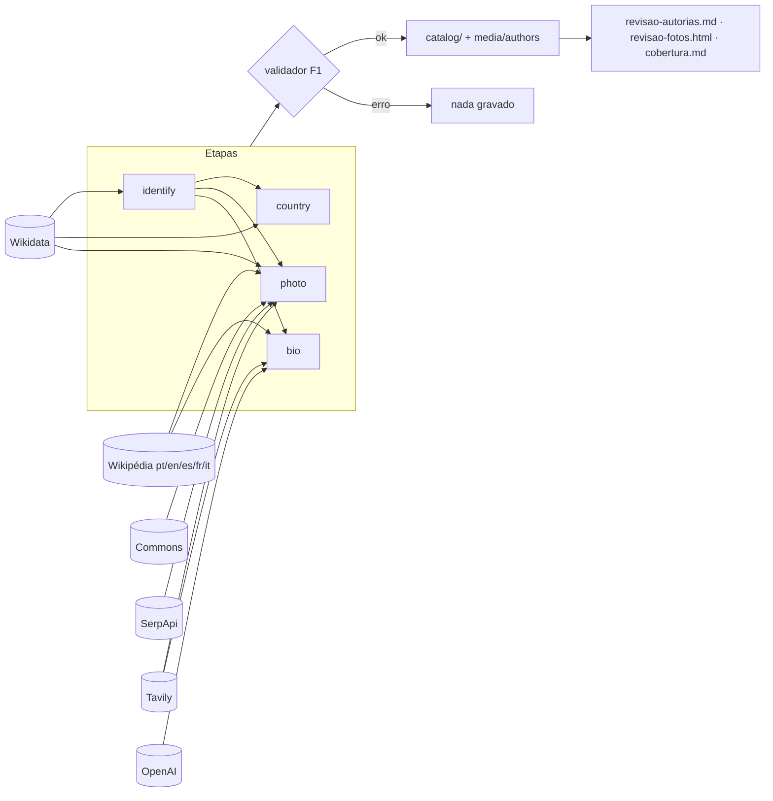

# Design — Enriquecimento de autorias (F2.1)

Referência: [`requirements.md`](requirements.md).

## Visão geral

Duas CLIs novas, só com a biblioteca padrão do Python 3.9:

- `pipeline/enrich_authors.py`: identifica cada autoria no Wikidata e preenche
  país, foto e bio (proposta), em etapas independentes.
- `pipeline/review_summaries.py`: aprova, rejeita e edita resumos (bios agora;
  ano e país na spec `resumos`).



Toda chamada externa passa por um único cliente HTTP com cache em disco. Os
testes trocam o transporte por respostas simuladas.

### Verificado com as APIs reais (2/nov/2026)

| Fonte | Resultado |
|---|---|
| Wikidata | Han Kang → `Q5646626`; `P27 = Q884` (Coreia do Sul); `P18` presente; SPARQL `P50` devolve "A Vegetariana" e "Lições de Grego" |
| Wikipédia pt | Introdução de Han Kang com 284 caracteres (calibrar o mínimo) |
| Commons | 1730×2326, `CC BY-SA 4.0`; `Artist` vem em HTML |
| SerpApi | Free Plan, 250 buscas/mês; `google_images` traz `original_width/height` e `source` |
| Tavily | Sem a obra na consulta, só LinkedIn; com "escritor" + obra, fontes boas e imagens com descrição |
| OpenAI | `gpt-5.4-mini` disponível e respondendo via Responses API |

## Volumes e orçamento

### Sondagem real (2/nov/2026, só Wikidata, grátis)

Busca pelo nome de cada uma das 215 autorias, sem confirmação por obra. Ou
seja, é uma estimativa:

| Medida | Autorias |
|---|---:|
| Com candidato escritor no Wikidata | 201 |
| Sem nenhum candidato (pouco conhecidas: Sidarta Ribeiro, Gabriela Prioli…) | 14 |
| Com mais de um escritor homônimo (dependem da confirmação por obra) | 10 |
| Com foto no Commons (`P18`) | 174 |
| Com cidadania (`P27`) / com mais de uma | 198 / 30 |
| Com verbete em pt/en/es/fr/it / com verbete em pt | 196 / 174 |
| **Precisam de busca de foto** (sem `P18` ou sem QID) | **~41** |
| **Precisam de busca de fonte para bio** (sem QID ou sem verbete) | **~19** (+ introduções curtas) |

### Consumo estimado da carga inicial

| Provedor | Cota grátis | Carga inicial | Por autoria nova (manutenção) |
|---|---|---|---|
| Wikidata, Wikipédia, Commons | sem cota (pausa de cortesia) | ~1.500 chamadas | ~8 |
| SerpApi | 250 buscas/mês | ~41 (até ~80 com uma 2ª consulta) | 0–1 |
| Tavily | 1.000 créditos/mês | ~20–60 | 0–2 |
| OpenAI (`gpt-5.4-mini`) | créditos pagos | 215 chamadas, ~US$ 0,40 | ~US$ 0,002 |

A carga inicial **cabe num mês** dos planos grátis, com folga no Tavily e
usando cerca de um terço da SerpApi. O risco real é dividir a cota com a spec
`capas`: 79 capas faltando, mais as de baixa resolução, também vão usar a
SerpApi. Por isso o orçamento é por provedor e por mês, compartilhado entre as
specs, e não por spec.

A manutenção é pequena. A Lila lê 2 ou 3 livros por mês, e muitas autorias se
repetem. Uma autoria nova custa no máximo 1 busca na SerpApi, 2 créditos no
Tavily e menos de 1 centavo na OpenAI.

## Modos de execução: carga inicial e manutenção

Os dois modos usam **a mesma CLI e as mesmas regras**. Muda só a seleção.

```text
carga inicial:  enrich_authors.py --wave 1 → revisão → --wave 2 → revisão → --wave 3 → revisão
manutenção:     enrich_authors.py --only nova-autora          (todas as etapas, mesmas regras)
```

### Seleção "pendente" (padrão)

Uma autoria está pendente numa etapa quando o campo dela está vazio **e** não
há decisão registrada:

| Etapa | Pendente quando | Não está pendente quando |
|---|---|---|
| `identify` | `wikidata` é `null` | estado definitivo (`confirmed`, `probable`, `manual`, `none`) ou `ambiguous`/`not_found` já registrado na mesma versão das regras |
| `country` | `country` é `null` e há QID | override presente |
| `photo` | `photo` é `null` | `author_photos.json` tem escolha ou `none`; ou candidatas já geradas e aguardando revisão |
| `bio` | não há resumo `autoria:{slug}` | rejeição registrada; ou a fonte já foi marcada como insuficiente |

`--refresh` e `--regenerate` reabrem os casos já decididos. Assim, rodar de
novo no mês seguinte retoma só o que ficou pendente ou foi adiado por cota.

### Ondas da carga inicial (`--wave`)

| Onda | Etapas e fontes | Custo |
|---|---|---|
| 1 | `identify`, `country`, `photo` (só Commons), coleta de fontes da Wikipédia | grátis |
| 2 | `bio` com fontes da Wikipédia (OpenAI) | ~US$ 0,40 |
| 3 | `photo` (Wikipédia `pageimages` → SerpApi → Tavily) e `bio` via Tavily, só nas que sobraram | cota |

Entre uma onda e outra, a revisão resolve as identificações ambíguas, porque
um QID fixado à mão destrava foto e bio grátis e evita gastar cota.

`--wave` só filtra as fontes permitidas. Sem `--wave`, valem todas as fontes,
que é o caso da manutenção.

### Prioridade

As autorias são processadas por visibilidade: nº de leituras (desc), depois
presença no ano corrente, depois slug. É a ordem de "Quem sempre volta" e "Em
{ano}". Se a cota acabar, as que mais aparecem no app já estarão prontas.

## Orçamento (`lib/budget.py`)

`pipeline/config/budgets.json` (versionado):

```json
{
  "serpapi": { "monthly": 250, "reserve": 40, "perRun": 120 },
  "tavily":  { "monthly": 1000, "reserve": 150, "perRun": 300 },
  "openai":  { "maxUsdPerRun": 2.0 }
}
```

- **Uso do mês** = o maior entre o livro-razão local
  (`pipeline/cache/usage/{provedor}-{AAAA-MM}.json`, incrementado a cada
  chamada de rede) e o uso informado pela API: SerpApi `GET /account`
  (`this_month_usage`) e Tavily `GET /usage` (`account.plan_usage`). As duas
  consultas não consomem cota e são feitas uma vez no início da execução.
  O teste real mostrou o Tavily com `plan_usage: 0` depois de 2 buscas. Ou seja,
  o número remoto pode atrasar, e por isso vale o maior dos dois.
- **Saldo** = `monthly − uso − reserve`, limitado a `perRun − usado nesta execução`.
- `Budget.spend(provider)` é chamado pelo `Http` **antes** de uma chamada de
  rede a um provedor com cota. Hits de cache não gastam nada. Sem saldo, ele
  levanta `BudgetExhausted`: a etapa daquela autoria vira "adiada por cota" e o
  laço segue, sem tentar outros provedores com cota para essa etapa.
- **OpenAI:** o custo acumulado da execução (por `usage`) é comparado com
  `maxUsdPerRun` antes de cada chamada.
- `--use-reserve` soma a reserva ao saldo. Fica para manutenção urgente ou para
  fechar a carga.
- O `--dry-run` mostra:

```text
provedor  necessárias  saldo  cabe?
serpapi            38    210  sim
tavily             27    850  sim
openai            194      —  ~US$ 0,37 (teto US$ 2,00)
```

  Se não couber, mostra até qual autoria (na ordem de prioridade) cabe.

## Configuração ajustável e aprendizados

Tudo o que a carga inicial pode ensinar fica em **configuração versionada**,
para que a manutenção herde os ajustes sem mudar código.

`pipeline/config/enrich.json`:

```json
{
  "rulesVersion": 1,
  "bioSourceLanguages": ["pt", "en", "es", "fr", "it"],
  "minIntroChars": 300,
  "minFallbackIntroChars": 120,
  "bio": { "minChars": 80, "maxChars": 450, "promptVersion": "author-bio-v1" },
  "photo": {
    "minSide": 400, "rejectBelow": 200, "commonsWidth": 1200, "maxCandidates": 3,
    "order": ["commons", "wikipedia", "serpapi", "tavily"]
  },
  "queries": {
    "serpapiPhoto": "{name} escritor {work}",
    "tavilyBio": "{name} escritor(a) {work} biografia"
  },
  "excludedDomains": ["linkedin.com", "facebook.com", "instagram.com", "tiktok.com", "x.com", "youtube.com"]
}
```

- `BIO_SOURCE_LANGUAGES` no `.env`, se definida, vence `bioSourceLanguages`.
- O prompt fica em `pipeline/config/prompts/author-bio-v1.md`. Mudar o prompt
  é criar `author-bio-v2.md` e apontar `promptVersion` para ele. Cada resumo
  grava `promptVersion`, e `--regenerate-prompt author-bio-v1` regenera só os
  **não aprovados** gerados pela versão antiga.
- `rulesVersion` sobe quando mudar uma regra de identificação. As autorias
  `ambiguous`/`not_found` registradas numa versão anterior voltam a ser
  pendentes.

### Registro de execuções

Toda execução real acrescenta uma entrada a
`docs/plans/enriquecimento-execucoes.md` (versionado):

```markdown
## 2026-11-03 · onda 1 · 215 autorias
| Etapa | Resultado |
|---|---|
| identify | confirmed 171 · probable 22 · ambiguous 9 · not_found 13 |
| country | 196 (6 entre vários, 3 Estado extinto) · sem país 19 |
| photo | commons 168 · adiadas p/ onda 3: 47 |
| fontes de bio | pt 151 · en 32 · es 4 · fr 3 · curtas 12 · sem verbete 13 |
Chamadas: wikidata 640 (cache 0) · wikipedia 410 · commons 168 · openai 0 · serpapi 0 · tavily 0
Custo: US$ 0,00 · Falhas: 0
```

É o único arquivo do projeto com data de execução no corpo, e de propósito:
ele é um log.

### Aprendizados

Ao fim da carga, `docs/plans/aprendizados-enriquecimento.md` registra, com base
no log: taxa de acerto por fonte, ajustes feitos em `enrich.json` e no prompt
(com o motivo), casos que exigiram decisão manual e o **custo médio por autoria
nova**. É a referência para o fluxo de "adicionar livro" da F5.

## Estrutura de arquivos

```text
pipeline/
  enrich_authors.py          CLI de enriquecimento
  review_summaries.py        CLI de revisão de resumos
  lib/
    env.py                   leitura de .env + ambiente; exige chaves por etapa
    http.py                  cliente HTTP: cache, retries, pausa, User-Agent, segredos
    providers/
      __init__.py
      wikidata.py            busca, entidades, SPARQL de obras
      wikipedia.py           sitelinks → introdução e imagem principal
      commons.py             URL, dimensões, licença e autor da imagem
      serpapi.py             Google Imagens
      tavily.py              busca de fontes + imagens
      openai_client.py       Responses API com saída estruturada
    authors/
      __init__.py
      identify.py            QID + estado + evidência
      country.py             país principal
      photo.py               candidatas, escolha e download
      bio.py                 fontes, prompt, proposta de bio
    images.py                tipo e dimensões de JPEG/PNG/WebP/GIF (stdlib)
    summaries.py             upsert, aprovar, rejeitar, editar
    budget.py                cotas mensais, livro-razão de uso, teto por execução
    selection.py             pendências, ondas e ordem de prioridade
    enrich_report.py         revisao-autorias.md, revisao-fotos.html, log de execuções
  config/
    enrich.json              parâmetros ajustáveis (limiares, consultas, ordem das fontes)
    budgets.json             cotas e reservas por provedor
    prompts/author-bio-v1.md prompt versionado da bio
    author_wikidata.json     QIDs fixados à mão
    author_photos.json       foto escolhida por autoria
    author_overrides.json    (F1) + "country"
    countries.json           países: ISO, nome pt-BR, idiomas oficiais; Estados extintos
    languages.json           nossos idiomas → QID do Wikidata
    writer_occupations.json  ocupações aceitas para "probable"
    summary_rejections.json  bios rejeitadas (não regenerar)
  cache/                     respostas de APIs (fora do git)
catalog/media/authors/       fotos mestre
```

## Modelo de dados

### Autoria (schema atualizado)

```json
{
  "slug": "han-kang",
  "name": "Han Kang",
  "aliases": [],
  "country": "KR",
  "countrySource": "wikidata-citizenship",
  "languages": ["coreano"],
  "primaryLanguage": "coreano",
  "wikidata": {
    "id": "Q5646626",
    "status": "confirmed",
    "evidence": "P50 em \"A Vegetariana\" (ISBN 9788588808294)"
  },
  "photo": {
    "file": "authors/han-kang.jpg",
    "license": "CC BY-SA 4.0",
    "author": "Johnsearsmedia",
    "sourceUrl": "https://commons.wikimedia.org/wiki/File:Han_Kang,_2024_Nobel_Prize_Laureate_in_Literature_(cropped).jpg",
    "source": "commons"
  },
  "references": [
    { "provider": "wikidata", "id": "Q5646626", "url": "https://www.wikidata.org/wiki/Q5646626" },
    { "provider": "wikipedia", "id": "en:Han Kang", "url": "https://en.wikipedia.org/wiki/Han_Kang" }
  ]
}
```

Mudanças no schema (`author.schema.json`):

| Campo | Mudança |
|---|---|
| `bio` | **removido**; a bio vive em `summaries.json` (Req. 5.6) |
| `countrySource` | novo; `enum: [wikidata-citizenship, wikidata-birthplace, override, null]` |
| `wikidata` | novo; `null` ou `{ id: ^Q[0-9]+$ ou null, status: enum, evidence: string }` |
| `photo.source` | novo; `enum: [commons, wikipedia, serpapi, tavily, manual]` |
| `photo.file` | caminho relativo a `catalog/media/`, `^authors/[a-z0-9-]+\.(jpg|png|webp|gif)$` |
| `photo.license` | passa a aceitar `null` (licença desconhecida) |

`status` ∈ `confirmed`, `probable`, `manual`, `ambiguous`, `not_found`, `none`
(`none` = marcado à mão como "sem Wikidata"). Nos estados `ambiguous`,
`not_found` e `none`, `id` é `null`.

### Resumo (schema atualizado)

```json
{
  "scope": "autoria:han-kang",
  "text": "Han Kang é uma escritora sul-coreana…",
  "approved": false,
  "updatedAt": "2026-11-02",
  "source": "Wikipédia (en)",
  "sourceUrl": "https://en.wikipedia.org/wiki/Han_Kang",
  "sourceLanguage": "en",
  "model": "gpt-5.4-mini",
  "promptVersion": "author-bio-v1",
  "editedBy": null
}
```

Campos novos: `sourceUrl`, `sourceLanguage`, `model`, `promptVersion`,
`editedBy` (`null | "human"`). Todos obrigatórios e anuláveis, como no resto do catálogo.

### Vocabulário de países

`vocabularies.json` ganha `countries`, uma lista de
`{ "code": "KR", "name": "Coreia do Sul", "languages": ["coreano"] }`, com os
países **usados** pelas autorias, ordenados por nome. A fonte é
`pipeline/config/countries.json`, que tem todos os países mapeados (gerado uma
vez a partir do Wikidata e revisado), mais a tabela de Estados extintos:

```json
{
  "countries": {
    "KR": { "qid": "Q884", "name": "Coreia do Sul", "languages": ["coreano"] },
    "BR": { "qid": "Q155", "name": "Brasil", "languages": ["português"] }
  },
  "defunct": {
    "Q15180": { "name": "União Soviética", "to": "RU" },
    "Q34266": { "name": "Império Russo", "to": "RU" },
    "Q33946": { "name": "Tchecoslováquia", "to": "CZ" },
    "Q36704": { "name": "Iugoslávia", "to": "RS" },
    "Q16957": { "name": "Alemanha Oriental", "to": "DE" },
    "Q43287": { "name": "Império Alemão", "to": "DE" },
    "Q28513": { "name": "Áustria-Hungria", "to": "AT" },
    "Q174193": { "name": "Reino Unido da Grã-Bretanha e Irlanda", "to": "GB" }
  }
}
```

O idioma de um país usa os mesmos nomes do catálogo ("coreano", "português"),
via `languages.json` (`{ "coreano": "Q9176", "português": "Q5146", … }`).
Idiomas oficiais vêm de `P37` do país.

## Cliente HTTP (`lib/http.py`)

```python
class Http:
    def __init__(self, cache_dir, transport=urlopen_transport, user_agent=None,
                 refresh=False, offline=False, min_interval=None): ...
    def get_json(self, provider, url, params=None, headers=None, secret_params=()) -> dict
    def post_json(self, provider, url, body, headers=None) -> dict
    def get_bytes(self, provider, url) -> (bytes, content_type)
```

- **Chave de cache:** `sha256` de `método + URL + params + corpo` **sem** os
  segredos (`api_key`, `Authorization`). Arquivo
  `pipeline/cache/{provider}/{hash}.json` com
  `{ request: {...sem segredos}, status, retrievedAt, body }`. Bytes de imagem
  vão em `{hash}.bin`, com um `.json` irmão de metadados.
- **Hit:** devolve do cache sem rede, salvo `refresh=True`.
- **`offline=True`** (usado no `--dry-run`): um miss não chama a rede. Ele
  levanta `CacheMiss`, que o planejador conta como "chamada necessária".
- **Retries:** 429 e 5xx até 4 tentativas, com espera de 1, 2, 4 e 8 s,
  respeitando `Retry-After`. Erros 4xx (exceto 429) falham na hora.
- **Pausa mínima por provedor:** Wikidata/Wikipédia/Commons 0,2 s; SerpApi e
  Tavily 1 s; OpenAI 0,5 s. Hits de cache não esperam.
- **User-Agent:** `WIKIMEDIA_USER_AGENT` em toda chamada a domínios Wikimedia.
- **Segredos:** headers e params marcados como segredo nunca vão para o cache
  nem para mensagens de erro. A mensagem de erro mostra a URL sem a query de
  segredos.
- Respostas de erro definitivo (404, "não encontrado") também ficam em cache,
  para não repetir.

`transport` é uma função `(method, url, headers, body) → (status, headers, bytes)`.
Os testes injetam um `FakeTransport` que casa prefixos de URL com fixtures.

## Ambiente (`lib/env.py`)

- Lê o `.env` da raiz (formato `CHAVE=valor`, aspas opcionais, `#` comentário).
  As variáveis de ambiente vencem o arquivo.
- `require(step)` confere as chaves de cada etapa:

| Etapa | Obrigatórias | Opcionais |
|---|---|---|
| `identify`, `country` | `WIKIMEDIA_USER_AGENT` | — |
| `photo` | `WIKIMEDIA_USER_AGENT` | `SERP_API_KEY`, `TAVILY_API_KEY` |
| `bio` | `WIKIMEDIA_USER_AGENT`, `OPENAI_API_KEY`, `OPENAI_MODEL` | `TAVILY_API_KEY` |

- Falta de chave obrigatória: código de saída 2, com a mensagem
  "defina X no .env (veja .env.example)". Opcional ausente: a fonte é pulada,
  com um aviso.

## Etapa `identify` (`authors/identify.py`)

Entrada: autoria + obras dela no catálogo.

1. **Escolha manual:** se `author_wikidata.json[slug]` existir, usa
   `{ "id": "Q…" }` (status `manual`) ou `{ "none": true }` (status `none`) e para.
2. **Candidatos:** `wbsearchentities` com `name` e cada alias, em `language=pt`
   e `language=en`, `limit=10`. A união é carregada em lote com
   `wbgetentities` (até 50 IDs, `props=claims|labels|aliases|sitelinks`).
   Ficam só os humanos (`P31` contém `Q5`).
3. **Confirmação por obra:** uma consulta SPARQL por autoria traz, para os
   candidatos, as obras com `P50`, seus rótulos (pt, en, es, fr, it, de e o
   idioma original), `P648` (Open Library) e os ISBNs das edições
   (`?ed wdt:P629 ?obra; wdt:P212|wdt:P957 ?isbn`). Uma obra do catálogo casa
   quando:
   - o ISBN-13 ou ISBN-10 da edição de referência (sem hífens) é igual a um ISBN; ou
   - o ID da Open Library das `references` (`/works/OL…W` → `OL…W`) é igual a `P648`; ou
   - o título normalizado (`unify_key` de `title`, `originalTitle`,
     `originalTitleRomanized` ou `edition.title`) é igual a algum rótulo
     normalizado da obra.

   A evidência registrada é o primeiro casamento, na ordem ISBN > Open Library
   > título (ex.: `P50 em "A Vegetariana" (ISBN 9788588808294)`).
4. **Decisão:**

| Situação | Estado |
|---|---|
| exatamente 1 candidato com obra casada | `confirmed` |
| ≥ 2 candidatos com obra casada | `ambiguous` (evidência lista os QIDs) |
| nenhum casado; exatamente 1 humano com ocupação de escrita (`P106` em `writer_occupations.json`) e nome igual (normalizado) a rótulo ou alias | `probable` |
| nenhum casado; ≥ 2 nessas condições | `ambiguous` |
| nada disso | `not_found` |

5. A etapa grava `wikidata` e a referência `wikidata`. Nos estados sem `id`,
   `country` e `photo` vindos do Wikidata **não** são preenchidos, e as etapas
   seguintes pulam essa autoria (exceto `bio` via Tavily e `photo` via
   SerpApi/Tavily).

`writer_occupations.json` (inicial): escritor `Q36180`, romancista
`Q6625963`, poeta `Q49757`, jornalista `Q1930187`, ensaísta `Q11774202`,
roteirista `Q28389`, dramaturgo `Q214917`, autor de literatura infantil
`Q4853732`, quadrinista `Q715301`, roteirista de quadrinhos `Q11892507`,
autor `Q482980`, contista `Q15949613`, colunista `Q1086863` (cobre o cronista
brasileiro; `Q3330547` é o cronista histórico), autobiógrafo `Q18814623`,
tradutor `Q333634`. Todos os QIDs desta lista foram conferidos no Wikidata.

## Etapa `country` (`authors/country.py`)

```text
se override.country → (override.country, "override")
se não há QID → mantém o que existe (null)
cidadanias = P27 da autoria, sem as que têm qualificador de fim anterior a 1800
mapear cada QID: countries.json pelo qid; senão defunct[qid].to; senão "não mapeado"
se 1 país → (país, "wikidata-citizenship")
se ≥ 2:
   a) os que têm primaryLanguage entre os idiomas oficiais
   b) desempate: país do local de nascimento (P19 → P17), se estiver entre eles
   c) desempate: ordem de P27 (rank preferred primeiro)
   → (escolhido, "wikidata-citizenship") e o caso vai para "país escolhido entre vários"
se 0 cidadanias: P19 → P17 → (país, "wikidata-birthplace")
senão null, e a autoria vai para "sem país"
```

Cidadanias de Estado extinto e QIDs não mapeados vão para o relatório. Um QID
não mapeado nunca vira país sozinho.

`countries.json` é gerado uma vez por `enrich_authors.py --build-countries`
(SPARQL: países soberanos com `P297`, rótulo pt e `P37`, filtrados para os
idiomas do catálogo). O arquivo é versionado e revisado à mão: nomes como
"Estados Unidos" em vez de "Estados Unidos da América".

## Etapa `photo` (`authors/photo.py`)

1. **Escolha manual** (`author_photos.json[slug]`): `{ "url": …, "source": … }`
   baixa essa imagem; `{ "none": true }` deixa `photo: null`; ausente, segue a regra.
2. **Commons (`P18`):** `imageinfo` com `iiurlwidth=1200` (miniatura servida
   pelo Commons; evita originais de 20 MB) e `extmetadata`. `license` =
   `LicenseShortName`; `author` = `Artist` sem HTML e sem espaços repetidos
   (`html.parser` da stdlib); `sourceUrl` = página do arquivo. A foto é
   **aceita automaticamente** (`source: commons`).
3. **Sem `P18`: candidatas para revisão**, até 3, sem repetir URL, nesta ordem:
   1. `pageimages` dos verbetes ligados ao QID (`BIO_SOURCE_LANGUAGES`), com `pithumbsize=1200`;
   2. SerpApi `google_images`, `q="{nome} escritor {título de uma obra}"`,
      `hl=pt-br`; descarta resultados com lado menor < 400 px e domínios de redes sociais;
   3. imagens do Tavily, reaproveitando a chamada da bio quando houver (Req. 3.2a).

   Nada é baixado nem gravado no catálogo. As candidatas vão para
   `revisao-fotos.html`, com miniatura, dimensões, fonte, título/descrição e o
   JSON pronto para colar em `author_photos.json`.
4. **Download** (escolhida ou Commons): `get_bytes`, tipo detectado pelos bytes
   mágicos (`images.py`: JPEG, PNG, WebP, GIF), dimensões lidas do cabeçalho.
   Rejeita o que não for imagem, ou tiver lado menor < 200 px. Entre 200 e
   400 px, aceita com aviso no relatório. O arquivo vai para
   `catalog/media/authors/{slug}.{ext}`.
5. A mesma foto (mesmo hash de conteúdo) não é regravada. Trocar a foto apaga
   o arquivo anterior da autoria.

## Etapa `bio` (`authors/bio.py`)

1. **Pular** se já houver resumo `autoria:{slug}` (salvo `--regenerate`), se
   ele estiver aprovado (sempre pular), ou se o escopo estiver em
   `summary_rejections.json` (salvo `--regenerate`).
2. **Fonte Wikipédia:** para cada idioma de `BIO_SOURCE_LANGUAGES` com
   sitelink no QID, buscar a introdução (`prop=extracts&exintro&explaintext`).
   Usar a primeira com `len ≥ minIntroChars` (`enrich.json`). Se nenhuma passar, usar a mais
   longa, desde que tenha ≥ 120 caracteres; abaixo disso, passar para o Tavily.
   `minIntroChars` começa em 300 e é calibrado na amostra.
3. **Fonte Tavily** (sem QID ou sem verbete útil):
   `"{nome} escritor(a) {título} biografia"`, `max_results=5`,
   `include_images=true`, `include_image_descriptions=true`, `exclude_domains`
   = redes sociais e vídeo. Ficam os resultados cujo `content` menciona o
   sobrenome. Até 3 trechos, somando no máximo 4.000 caracteres.
4. **Resumo (OpenAI Responses API)**, `model = OPENAI_MODEL`, saída estruturada:

```json
{
  "type": "json_schema",
  "name": "author_bio",
  "strict": true,
  "schema": {
    "type": "object",
    "additionalProperties": false,
    "required": ["insufficient", "text", "source_index"],
    "properties": {
      "insufficient": { "type": "boolean" },
      "text": { "type": "string" },
      "source_index": { "type": "integer" }
    }
  }
}
```

   Prompt (`config/prompts/author-bio-v1.md`, instruções de sistema em pt-BR), em resumo:
   - escreva 2 a 3 frases em português do Brasil, até 400 caracteres, sobre {nome};
   - use **só** os fatos das fontes numeradas abaixo e traduza se preciso;
   - inclua origem, período e o que caracteriza a obra; sem opinião, superlativos
     ("um dos maiores"), prêmios em excesso ou vida pessoal sem relação com a obra;
   - não cite os livros da estante pelo nome, salvo se as fontes destacarem o livro;
   - se as fontes não tratarem claramente dessa pessoa, responda `insufficient: true`.

   A mensagem do usuário traz nome, aliases, país (se houver), títulos das
   obras na estante (só para desambiguar) e as fontes numeradas, com idioma e URL.
5. **Verificações pós-resposta:** `insufficient` → sem bio, vai para o
   relatório. O texto precisa estar entre 80 e 450 caracteres, conter o
   sobrenome e ter `source_index` válido. Se falhar, uma nova tentativa; se
   falhar de novo, a autoria vai para o relatório.
6. **Gravação:** `summaries.upsert(scope, text, source, sourceUrl,
   sourceLanguage, model)` com `approved: false`, `editedBy: null`,
   `updatedAt` = data de hoje (só muda quando o texto muda).
7. **Custos:** tokens de `usage` somados por execução. Custo =
   tokens × `OPENAI_PRICE_*_PER_M`. A estimativa do `--dry-run` usa
   caracteres/4 de entrada e 150 tokens de saída por bio. Pela ordem de
   grandeza, 215 bios × (~1.500 tokens de entrada + ~150 de saída) ≈ US$ 0,40.

## Resumos e revisão

### `lib/summaries.py`

- `upsert(cat, scope, **fields)`: insere ou atualiza; mantém a lista ordenada
  por `scope`. Nunca altera um item com `approved: true`, salvo se a operação
  vier da CLI de revisão.
- `approve(scope)`, `reject(scope)` e `edit(scope, text)` (marca
  `editedBy: "human"`; não aprova sozinho).

### `pipeline/review_summaries.py`

```text
python3 pipeline/review_summaries.py --list [--pending] [--scope-prefix autoria:]
python3 pipeline/review_summaries.py --approve autoria:han-kang [autoria:…]
python3 pipeline/review_summaries.py --approve-file aprovados.txt
python3 pipeline/review_summaries.py --reject autoria:fulana
python3 pipeline/review_summaries.py --edit autoria:han-kang --text "…" [--and-approve]
```

Toda alteração passa pelo validador antes de gravar. `--reject` remove o
resumo e acrescenta o escopo em `pipeline/config/summary_rejections.json`.

> Ajuste em relação ao Req. 6.4: a rejeição fica em **configuração
> versionada**, e não no cache. É uma decisão humana, e o cache é descartável.

### Relatórios (`lib/enrich_report.py`)

- `docs/plans/revisao-autorias.md` (versionado, determinístico): uma seção por
  autoria **com pendência**:
  - identificação ambígua ou não encontrada (com os candidatos e as descrições);
  - país entre vários ou não mapeado;
  - sem foto (com o número de candidatas);
  - bio pendente de aprovação (texto + fonte), ou sem bio (motivo).

  No fim, um bloco com os comandos prontos de `review_summaries.py --approve`.
- `docs/plans/revisao-fotos.html` (fora do git): uma grade de cartões por
  autoria, com as candidatas. Usa `` remoto só nesta página local de
  revisão, nunca no app.
- `docs/plans/cobertura.md`: a seção **Autorias** passa a mostrar a tabela
  por estado de identificação, país, foto (commons × outras), bio proposta e
  bio aprovada, além das listas pedidas no Req. 9.2.

## CLI `enrich_authors.py`

```text
python3 pipeline/enrich_authors.py
    [--steps identify,country,photo,bio]   (padrão: todas)
    [--wave 1|2|3]                         (carga inicial; sem --wave = todas as fontes)
    [--only slug1,slug2] [--limit N]       (padrão: só pendentes, por prioridade)
    [--refresh] [--regenerate] [--regenerate-prompt VERSÃO]
    [--use-reserve] [--dry-run]
    [--build-countries]
```

Fluxo:

1. `load_catalog` → `check_catalog`. Se o catálogo de partida já for
   inválido, o script para.
2. `Budget.load()`: livro-razão local + `/account` e `/usage` remotos.
3. Seleção (`selection.py`): pendentes, ou `--only`, na ordem de prioridade,
   cortados por `--limit`. Para cada autoria, as etapas rodam em ordem, com as
   fontes permitidas pela onda. A falha de uma autoria é registrada e o laço
   segue. `BudgetExhausted` marca a etapa como "adiada por cota".
3. Fotos baixadas ficam num diretório temporário.
4. `check_catalog` sobre o resultado em memória (com a regra nova
   `photo.file` existe). Se for inválido, nada é gravado e as fotos
   temporárias são descartadas.
5. Grava pelo `write_catalog` da F1 (atômico), move as fotos para
   `catalog/media/authors/`, remove as fotos substituídas e gera os relatórios.
6. Resumo final: autorias por estado, países, fotos, bios, adiadas por cota,
   chamadas por provedor (rede × cache), saldo restante, tokens e custo,
   falhas. A mesma informação vai como entrada nova em
   `docs/plans/enriquecimento-execucoes.md`.

Códigos de saída: `0` ok; `1` alguma autoria falhou ou o catálogo resultante
é inválido; `2` chave obrigatória ausente ou catálogo de partida inválido.

**`--dry-run`:** bloqueia só o que custa ou é pesado: OpenAI, SerpApi, Tavily
e downloads de imagem (`offline_providers`). Wikidata, Wikipédia e Commons
respondem normalmente e vão para o cache. Sem isso, a etapa parava na primeira
chamada grátis fora do cache e subestimava o que é pago (achado nos testes).
Cada miss bloqueado conta como chamada necessária, e a etapa daquela autoria
para ali. Mostra a contagem por provedor e o custo estimado da OpenAI. Não
grava nada no catálogo nem nos relatórios.

### Ajustes feitos na implementação

- `wikidata` da autoria ganhou `rulesVersion`, para reabrir casos
  `ambiguous`/`not_found` quando as regras mudarem.
- `languages.json` mapeia cada idioma para QID **e** código ISO, porque os
  rótulos das obras são buscados também no idioma original.
- A imagem principal da Wikipédia (grátis) entra já na onda 1, junto com o
  Commons. A onda 3 acrescenta só SerpApi e Tavily.
- Estado local das etapas (candidatas, fontes tentadas, notas) em
  `pipeline/cache/enrich_state.json`. É descartável, porque se reconstrói pelo cache.
- `review_summaries.py --edit … --text … --and-approve` (em vez de
  `--approve`, que conflita com o comando de aprovação).
- Títulos normalizados com NFC depois de tirar os acentos (o NFKD separava as
  sílabas do coreano em jamos).

## Mudanças na F1

- **`build.py` preserva o enriquecimento:** a migração recebe as autorias
  existentes (`load_catalog`) e, para cada slug que continua existindo, copia
  `country`, `countrySource`, `wikidata`, `photo` e as `references` que não
  vieram do legado. Se uma autoria deixar de existir, o arquivo de foto dela
  **não** é apagado.
  O arquivo fica, e o relatório de cobertura lista fotos órfãs (não é erro de
  validação).
- **`checks.py`:** novas regras
  - `vocab.country`: `country` ∈ `vocabularies.countries[].code`;
  - `photo.file`: o arquivo de `photo.file` existe em `catalog/media/`;
  - `summary.scope-unique`: no máximo um resumo por `scope`.
- **`vocabularies.json`:** passa a ter `countries`, com os países usados.
  A migração preserva `countries` em vez de recalcular.
- **`author_overrides.json`:** aceita `"country": "PT"`.

## Tratamento de erros

| Situação | Comportamento |
|---|---|
| Chave obrigatória ausente | código 2, mensagem com o nome da variável |
| HTTP 429/5xx | retries com espera; se esgotar, falha da autoria (as outras seguem) |
| Resposta inesperada de API | falha da autoria, com provedor e URL (sem segredos) |
| OpenAI recusa ou JSON inválido | uma nova tentativa; depois, falha da autoria |
| Imagem inválida ou pequena demais | `photo` não muda, vai para o relatório |
| Catálogo resultante inválido | nada gravado, fotos temporárias descartadas, código 1 |
| Ctrl+C no meio | nada gravado; o cache já obtido é mantido |

## Estratégia de testes

Todos os testes são offline, com o `FakeTransport` e fixtures pequenas em
`pipeline/tests/fixtures/enrich/`, recortadas das respostas reais testadas
(Han Kang, Itamar Vieira Junior) e de casos sintéticos.

| Arquivo | Cobre |
|---|---|
| `test_http.py` | cache hit/miss, `refresh`, `offline` → `CacheMiss`, retries com `Retry-After`, segredos fora do cache e das mensagens, User-Agent Wikimedia |
| `test_env.py` | `.env` com aspas e comentários, ambiente vence arquivo, chave obrigatória ausente |
| `test_identify.py` | confirmação por ISBN, por Open Library e por título; `probable`; `ambiguous` (2 confirmados e 2 prováveis); `not_found`; manual e `none` |
| `test_country.py` | uma cidadania; várias com desempate por idioma, por nascimento e por ordem; Estado extinto; QID não mapeado; só local de nascimento; override |
| `test_photo.py` | Commons aceito com licença e autor limpos; candidatas na ordem e sem repetir; filtro de tamanho e de redes sociais; escolha manual; `none`; imagem inválida |
| `test_images.py` | tipo e dimensões de JPEG, PNG, WebP e GIF mínimos gerados em teste |
| `test_bio.py` | escolha de idioma por tamanho; fallback para a mais longa; fallback para Tavily; filtro por sobrenome; `insufficient`; verificação de tamanho/sobrenome com nova tentativa; não sobrescreve aprovada; rejeitada não regenera; `--regenerate` |
| `test_summaries.py` | upsert, ordem por escopo, aprovar, rejeitar, editar, escopo único |
| `test_budget.py` | saldo = limite − max(local, remoto) − reserva; teto por execução; `--use-reserve`; cache não gasta; `BudgetExhausted` adia só a etapa; teto de US$ da OpenAI |
| `test_selection.py` | pendências por etapa e decisões que encerram; `rulesVersion` reabre ambíguas; ordem de prioridade; fontes por onda |
| `test_enrich_cli.py` | ponta a ponta numa fixture com 3 autorias; `--dry-run` sem rede nem gravação, com a tabela de orçamento; segunda execução byte a byte igual e sem chamadas; catálogo inválido não grava nada; entrada no log de execuções; manutenção com `--only` igual à carga |
| `test_review_cli.py` | cada comando, `--approve-file` e validação antes de gravar |
| `test_migrate.py` (F1) | migração preserva `country`, `wikidata`, `photo` e `countries` |

## Plano de execução real

1. Gerar e revisar `countries.json` (`--build-countries`).
2. **Amostra de 10 autorias** (`--only`), misturando casos fáceis e difíceis:
   Han Kang, Machado de Assis, Elena Ferrante (pseudônimo, sem foto),
   Liev Tolstói (grafia pt), valter hugo mãe, Luís Fernando Veríssimo,
   Sidarta Ribeiro (sem QID na sondagem), uma com coautoria, um autor
   russo/soviético e um hebraico. Todas as ondas. Calibrar `enrich.json` e o
   prompt; registrar no log.
3. Onda 1 em todas → revisar identificações ambíguas (fixar QIDs) e países.
4. Onda 2 → revisar uma amostra de bios; ajustar o prompt se preciso
   (`author-bio-v2` + `--regenerate-prompt`).
5. `--dry-run --wave 3` para conferir o orçamento → onda 3.
6. Revisão com a Lila: escolher fotos e aprovar bios.
7. Escrever `aprendizados-enriquecimento.md`.

## Decisões e alternativas descartadas

| Decisão | Alternativa | Motivo |
|---|---|---|
| Confirmar QID por obra da estante | aceitar o 1º resultado da busca | homônimos (teste: "Han Kang" também é um rio e um médico) |
| Foto do Commons automática; as demais com revisão | escolher a 1ª da busca de imagens | a busca traz fotos de outras pessoas, capas e eventos |
| SerpApi antes do Tavily para fotos | só Tavily | SerpApi traz dimensões e fonte; o Tavily só a URL e a descrição |
| Miniatura de 1200 px do Commons | original | originais chegam a dezenas de MB; 1200 px sobra para o app |
| Bio em `summaries.json` | campo `bio` na autoria | um só fluxo de aprovação para bio, ano e país |
| Rejeições em configuração versionada | no cache | decisão humana não pode sumir ao limpar o cache |
| `countries.json` versionado | consultar países a cada execução | nomes pt-BR revisados à mão e execução estável |
| HTTP com `urllib` e cache próprio | `requests`, SDK da OpenAI | regra de só biblioteca padrão; as APIs usadas são JSON simples |
| Mesma CLI para carga e manutenção | script separado de carga em lote | as regras calibradas na carga valem automaticamente para cada livro novo |
| Orçamento por provedor e por mês | por spec | SerpApi e Tavily serão divididos com a spec `capas` |
| Ondas com revisão entre elas | tudo de uma vez | fixar QIDs ambíguos antes da onda 3 economiza cota |
| Parâmetros e prompt em configuração | constantes no código | aprendizados mudam o comportamento sem mexer em código; `promptVersion` permite regenerar seletivamente |
