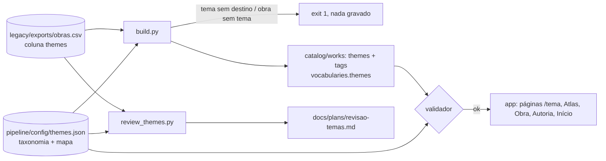

# Design — Temas (F2.3)

Referência: [`requirements.md`](requirements.md).

## Visão geral

A normalização acontece **uma vez, no build do catálogo**, a partir de um arquivo
de dados revisado por humanos. O app quase não muda: ele já agrupa temas por slug
(`themeIndex`) e já gera uma página por tema (`buildThemePages`), então reduzir o
vocabulário de 493 para ~50 reduz as páginas sem regra nova.

- **Pipeline:** um módulo novo (`lib/themes.py`) carrega e valida `themes.json` e
  aplica o mapa; `build.py` o chama na migração; o validador ganha duas regras; a
  cobertura ganha uma seção; uma CLI de leitura (`review_themes.py`) gera o
  documento de revisão.
- **App:** `tags` entra no Zod (e fica fora do modelo), `NavChips` aceita "nenhum
  ativo" e nasce o `404.astro`.



`migrate_legacy.py` continua sendo o único escritor de `themes` e `tags`. O
documento de revisão e o validador só leem.

## Dados

### `pipeline/config/themes.json`

```json
{
  "version": 1,
  "targetSize": [40, 60],
  "taxonomy": ["amor", "família", "identidade", "memória", "..."],
  "map": {
    "memória": ["memória"],
    "tempo e memória": ["memória"],
    "violência doméstica": ["violência", "família"],
    "crise dos opioides": [],
    "Nordeste": ["nordeste"]
  }
}
```

- `taxonomy`: temas canônicos em minúsculas, na ordem alfabética (`vocab_sort_key`).
- `map`: chave = tema original (qualquer grafia; vale a **chave de comparação**);
  valor = lista de temas canônicos. `[]` = só tag.
- `targetSize` (R1.2) vive no arquivo, não no código: os testes usam taxonomias de
  3 temas com `[1, 10]`, e o arquivo real é validado em `[40, 60]`.
- A chave de comparação é `names.unify_key` (sem acento, minúsculo, espaços
  normalizados), a mesma já usada nas autorias. Resolve as 3 variantes de caixa.

### Esquema da obra

`work.schema.json` e o Zod ganham `tags` (`textList`), **opcional** como `file`/
`focus` da capa. Fixtures e obras sem `tags` seguem válidas. Ordem das chaves no
JSON da obra: `themes`, depois `tags`.

```json
"themes": ["identidade", "memória"],
"tags": ["tempo e memória", "identidade judaica", "Nova York"]
```

`vocabularies.themes` continua derivado das obras (`build.py` já faz isso), agora
com os canônicos em uso.

## Pipeline

### `lib/themes.py` (novo)

| Função | Papel |
|---|---|
| `theme_key(s)` | chave de comparação (`unify_key`) |
| `slugify_theme(s)` | espelho de `slugifyTheme` do app (NFD sem acento, minúsculo, não `[a-z0-9]` vira `-`) para detectar colisão de slug |
| `ThemeConfig.load(path)` | lê, valida e devolve a configuração; levanta `ThemeConfigError` |
| `apply(raw, cfg)` | `raw` (lista do CSV) → `Applied(themes, tags, unmapped)` |
| `summary(works, cfg)` | contagens para `--dry-run`, cobertura e revisão |

Validação em `load` (todas levantam `ThemeConfigError`):

1. `version == 1`; `targetSize` com dois inteiros; `len(taxonomy)` dentro dele (R1.2).
2. Taxonomia em minúsculas, sem repetição pela chave e sem colisão de slug (R1.2, R1.3).
3. Chaves do `map` sem repetição pela chave de comparação (R2.6).
4. Todo destino do `map` existe na taxonomia (R2.4).
5. Todo tema da taxonomia é alcançado por alguma entrada (R2.5).

`apply` (determinístico, sem estado):

```python
def apply(raw, cfg):
    themes, tags, seen, unmapped = [], [], set(), []
    for t in raw:                      # ordem do CSV, já sem repetição exata
        key = theme_key(t)
        if key not in seen:            # tags: sem perda, uma por chave, grafia do CSV
            seen.add(key); tags.append(t)
        targets = cfg.map.get(key)
        if targets is None:
            unmapped.append(t); continue
        for c in targets:
            if c not in themes:        # união ordenada, primeira aparição
                themes.append(c)
    return Applied(themes, tags, unmapped)
```

### Integração no build (R3)

`build(legacy, registry, overrides, existing_summaries, existing, themes=None)`:

- `themes=None` mantém o comportamento atual (`themes` cru, sem `tags`). É o caminho
  das fixtures antigas e de uso como biblioteca; a migração **sempre** passa a
  configuração.
- Com configuração, cada obra recebe `themes` e `tags` de `apply`. Os problemas
  são acumulados de todas as obras e viram **um** erro no fim: `ThemeMappingError`
  (subclasse de `LegacyDataError`) com as duas listas, "temas sem mapeamento" (tema
  e título da obra) e "obras sem tema" (título e originais).
- `vocabularies.themes` é calculado como hoje, a partir de `themes`.
- Nada de `themes` anterior é lido: o resultado depende só do CSV e do arquivo (R3.7).

`migrate_legacy.py`:

- Carrega `config/themes.json` antes de construir. `ThemeConfigError` ou arquivo
  ausente → mensagem e **código 2** (R3.5). `LegacyDataError` (inclui o erro de
  mapeamento) → código 1, nada gravado, como já é.
- Passa a configuração a `check_catalog`, para o validador conferir a própria saída.
- `--dry-run` imprime uma linha a mais: `temas: N canônicos · M originais · K
  abaixo do piso (5)` (R3.8). As pendências já aparecem no erro de mapeamento.

### Validador (R4)

`check_catalog(cat, schemas, undated_head=None, themes_cfg=None)`. Com
configuração, duas regras novas em `check_themes`:

| Regra | Condição | Mensagem |
|---|---|---|
| `theme.taxonomy` | tema de obra, ou de `vocabularies.themes`, fora da taxonomia | `tema 'x' fora da taxonomia (themes.json)` |
| `theme.drift` | obra com `tags` cujo `apply(tags).themes` difere de `themes` | `themes não bate com o mapa: rode migrate_legacy.py` (R4.4) |

`validate_catalog.py` procura `themes.json` em `catalog_dir.parent/pipeline/config`.
Se existir, carrega e passa à verificação; se não existir (catálogos de teste em
diretórios temporários), as regras são puladas. Um `themes.json` inválido vira
erro do validador (código 1). Os escritores de enriquecimento (`enrich_authors`,
`enrich_covers`) não tocam em `themes` e seguem sem passar a configuração.

A regra `vocab` existente continua, mas sozinha não protege: o vocabulário é
derivado das próprias obras. Por isso `theme.taxonomy` compara com o arquivo.

### Cobertura (R4.5)

`lib/coverage.py` ganha `## Temas`, calculado só do catálogo:

- temas canônicos; média de temas por obra; obras com um único tema;
- os 10 temas com mais obras;
- temas abaixo do piso (`THEME_FLOOR = 5`, constante em `lib/themes.py`, espelho de
  `CLOUD_MIN_WORKS` do app, com comentário nos dois lados);
- total de `tags`.

O piso é só relatório: não bloqueia (R1.4).

### Revisão (R5): `pipeline/review_themes.py`

CLI de **leitura**: `read_legacy` + `ThemeConfig.load` → `docs/plans/revisao-temas.md`.
Não grava no catálogo nem em `legacy/`. Obras são identificadas pelo título do CSV
(o slug exige o registro de slugs, que é do escritor).

Estrutura do documento (ordem fixa, tudo ordenado por obras desc e depois texto):

1. cabeçalho com totais e o número abaixo do piso;
2. **Pendências**, só se houver: originais sem entrada no mapa, com a obra;
3. **Resumo**: tabela `tema canônico | obras | originais que caem nele`;
4. **Um bloco por tema canônico**: lista dos originais com a contagem de obras de
   cada um e as obras que ficam *só* com esse tema;
5. **Só tag** (lista vazia) e **Mapeados para mais de um tema**;
6. **Atenção**: obras que ficam com um único tema e obras que perdem mais da
   metade dos originais.

Saída determinística (R5.5); um original ausente do mapa nunca é omitido, aparece
na seção de pendências.

### Como a taxonomia e o mapa iniciais serão redigidos (R9)

Trabalho meu, sem serviço pago e sem código no repositório:

1. Em `temp/temas/`, listo os 496 originais com a contagem de obras e os temas
   que co-ocorrem.
2. Parto dos 52 temas com 5+ obras como núcleo. Decido fusões (por exemplo,
   variantes do mesmo assunto) e uns poucos temas novos que reúnem a cauda
   (guerra, ditadura, colonialismo, religião, trabalho...), cada um com pelo menos
   o piso.
3. Mapeio cada original: ao núcleo, a um tema novo, a dois temas, ou "só tag".
4. Gero `revisao-temas.md`, itero com você e com a Lila, e só então rodo a migração.

O rascunho de `themes.json` fica fora do commit até a aprovação. Quando a
migração rodar, `themes.json` e o catálogo normalizado entram **no mesmo commit**:
antes disso, o validador rejeitaria o catálogo cru (`theme.taxonomy`).

## App

O app não lê `themes.json` (regra: `app/` só lê `catalog/`).

### O que não muda

- `themeIndex`/`buildThemePages`: uma página por slug; com ~50 canônicos, ~50 páginas.
- Início: `buildThemeRails` continua com os 4 mais frequentes (`THEME_RAIL_COUNT`).
- Nuvem do Atlas (piso 5, teto 30), chips da Obra (contagem a partir de 5), temas
  da Autoria (2+ obras, top 10): sem alteração. Como todo canônico cumpre o piso, a
  contagem passa a aparecer em todos os chips da Obra; é consequência, não regra
  nova.
- Busca: o índice não usa temas.

### O que muda

1. **`schema.ts`**: `workSchema` ganha `tags: textList.optional()`. `model.ts` não
   copia `tags` para `WorkView` (R6.4); um teste garante.
2. **`NavChips.astro`**: `active` passa a aceitar `null` (nenhum chip ativo, os
   três viram links). A comparação `chip.id === active` já cobre; páginas
   existentes ficam com HTML idêntico (provado pelo diff).
3. **`pages/404.astro`** (R8): `Base` com `noindex` e título "Página não encontrada",
   `h1` "Esse endereço não existe", uma frase ("O link pode estar errado ou ter
   mudado.") e `NavChips active={null}` (Início, Atlas, Linha do tempo, 44 px).
   Mesma moldura de cabeçalho das telas de listagem; sem JavaScript, sem catálogo.
   O Astro gera `dist/404.html`.

### 404 no Cloudflare Pages

Hoje não há `404.html`, e o Pages trata o projeto como SPA: serve `index.html` com
200 para qualquer rota. Com `404.html` na raiz, o Pages passa a servi-lo com
status 404 para rotas sem arquivo. Isso é comportamento documentado do Pages, mas
não foi testado neste projeto; a verificação é no preview do PR
(`curl -sI <preview>/tema/algo-que-nao-existe` deve dar 404) e o resultado vai
para o `tasks.md` (R8.4). Se o status continuar 200, o `404.html` ainda serve de
conteúdo e a causa é investigada antes do merge.

## Decisões e alternativas

- **Aplicar o mapa no build, não numa etapa separada sobre o catálogo.** A migração
  recompõe `themes` do CSV a cada execução; uma etapa depois dela seria desfeita
  por ela. Aplicar dentro do build é o mesmo desenho do `merge_cover`.
- **`tags` guarda os originais sem perda** (uma por chave, grafia do CSV), não só
  os que sobraram. Assim o catálogo se basta: o validador refaz o mapeamento a
  partir das `tags` (`theme.drift`) sem o CSV legado, que está fora do git.
- **Alternativa não adotada:** uma CLI `normalize_themes.py` que reaplica o mapa às
  `tags` do catálogo, sem o legado. Resolveria ajustes futuros em outra máquina,
  mas é um segundo escritor de `themes`. Fica anotada; hoje a migração basta
  porque o legado existe na máquina do mantenedor.
- **Mapa de lista, não de um valor.** "Violência doméstica" é violência e família;
  um valor só forçaria perda de informação.
- **Piso como relatório, não como erro.** Uma obra removida não pode travar o
  catálogo (R1.4).
- **`targetSize` no arquivo.** Mantém o limite de 40–60 como decisão de dados e
  deixa os testes pequenos.
- **Sem redirecionamento das URLs antigas.** Nada foi compartilhado (a S7 não
  existe), e ~440 temas viram 1 só destino: o 404 é suficiente. O mapa permitiria
  gerar `_redirects` depois, se algum dia importar.
- **Início sem lista editorial.** Decisão tomada; o único incômodo registrado é o
  carrossel "família", que continua.

## Testes (R10)

**Pipeline (`pipeline/tests/test_themes.py`, `unittest`, offline):**

- `apply`: união ordenada sem repetição; um para vários; lista vazia vira só tag;
  variantes de caixa e acento compartilham entrada; `tags` sem perda na ordem do CSV.
- `ThemeConfig.load`: tema do mapa fora da taxonomia; taxonomia sem uso; chaves
  repetidas pela chave; slug colidindo; fora do `targetSize`; arquivo ausente.
- `build`: tema sem mapeamento e obra sem tema acumulados num só erro; `themes=None`
  igual ao comportamento antigo; vocabulário igual aos canônicos em uso.
- `migrate_legacy`: código 1 com nada gravado (`tree_bytes` igual); código 2 sem
  `themes.json`; idempotência byte a byte; um catálogo já normalizado não é desfeito
  ao migrar de novo; `--dry-run` imprime a linha de temas.
- Validador: `theme.taxonomy` e `theme.drift` (válido e inválido); sem
  configuração, as regras são puladas.
- Cobertura: seção de temas e abaixo do piso.
- Revisão: documento determinístico, cobre todos os originais, pendência em destaque.
- **Catálogo real:** teste que carrega `catalog/` e `pipeline/config/themes.json`
  versionados e exige `check_catalog(..., themes_cfg) == []`. Evita deriva entre
  mapa e catálogo.
- Fixtures: `test_cli.py` (setUp e `ValidateCliTest`) e demais chamadores de
  `migrate_legacy.run` ganham um `themes.json` mínimo via helper, porque a migração
  agora exige o arquivo.

**App (`node --test`):**

- `schema.test.ts` (novo): Zod aceita `tags` e continua rejeitando campos
  desconhecidos.
- `model.test.ts`: `WorkView` não expõe `tags`.
- `home.test.ts` já cobre "4 mais frequentes"; só confirmar que segue verde.
- `route-integrity`: sem mudança de código; roda sobre os temas novos.

**Verificação no build (não é teste unitário):** `dist/404.html` existe e tem os
três links; nenhuma `tag` que não seja tema canônico aparece em `dist/` (nem em
`search-index.json`); número de páginas = `1080 − (493 − N) + 1`.

## Verificação (fecho da spec)

1. `python3 -m unittest discover -s pipeline/tests` verde.
2. `python3 pipeline/validate_catalog.py` com 0 erros, incluindo `theme.taxonomy` e
   `theme.drift`.
3. `npm run check`, `node --test` e `npm run build` em `app/`; total de páginas pela
   fórmula do R6.6.
4. Diff de HTML contra a `main` (baseline em `temp/`): Linha do tempo, Ano, País,
   Idioma e Sem data sem mudança; mudam só Início, Atlas, Tema, Obra e Autoria.
5. Preview do PR: `curl -sI` numa rota inexistente (status 404) e olhada em
   Início, Atlas (nuvem), uma Obra e uma Autoria, no desktop e no celular.
6. Atualizar `ROADMAP.md`, `AGENTS.md` (comando `review_themes.py`),
   `DESIGN_HANDOFF.md` (§12.4 resolvido) e escrever o handover.

## Fora do escopo (reafirmado)

Exibir ou pesquisar `tags`; lista editorial ou exclusão de temas no Início;
redirecionamentos; geração automática da taxonomia (ideia anotada no ROADMAP);
resumos, dados das obras, polimento do desktop, S6 e S7.
